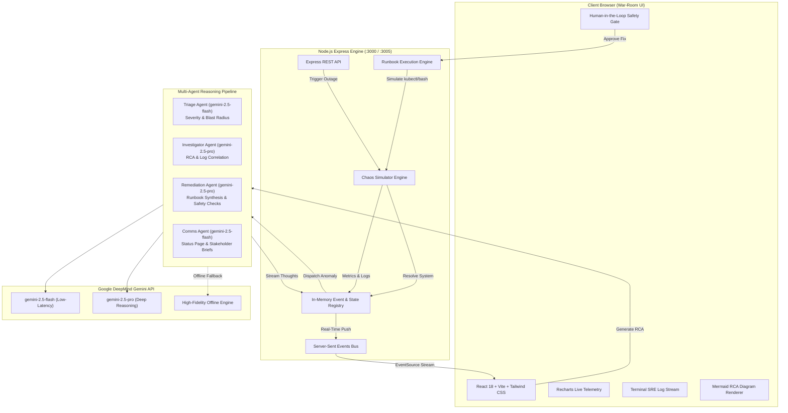

# ⚡ IncidentPulse AI — Real-Time Autonomous SRE War-Room Platform

[](tests/)
[](https://deepmind.google/technologies/gemini/)
[](Dockerfile)
[](frontend/)
[](backend/)
[](LICENSE)

IncidentPulse AI is a real-time, autonomous Site Reliability Engineering (SRE) war-room platform powered by Google Gemini 2.5. When critical infrastructure anomalies occur, the platform autonomously correlates high-velocity streaming logs, isolates root causes with coordinated LLM agents, synthesizes executable remediation runbooks with Human-in-the-Loop safety approval, and generates comprehensive post-mortems with interactive architecture diagrams.

---

## 📹 Video Walkthrough & Product Demo

Watch the complete 2-minute autonomous incident response demonstration:

- **Full Demo Video Recording:** [`demo_recording.mp4`](demo_recording.mp4)
- **Demo Production Package & Script:** [`docs/DEMO_GUIDE.md`](docs/DEMO_GUIDE.md)

### 2-Minute Demo Breakdown

| Timeline | Stage | Highlighted Action |
| :--- | :--- | :--- |
| **0:00 - 0:15** | Steady-State Telemetry | Live Recharts streaming healthy baseline (p50: 42ms, Error Rate: 0.04%, Systems Steady). |
| **0:15 - 0:30** | Chaos Injection | Triggering Scenario A (Stripe 504 Timeout Cascade) via bottom Chaos Dock; Sev-1 Critical alert declaration. |
| **0:30 - 0:50** | Multi-Agent Reasoning | Triage Agent (Gemini 2.5 Flash) and Investigator Agent (Gemini 2.5 Pro) correlate logs and pinpoint thread pool exhaustion in real time. |
| **0:50 - 1:10** | Runbook Synthesis | Remediation Agent formulates a four-step Kubernetes runbook with declarative configuration diff preview. |
| **1:10 - 1:30** | Human-in-the-Loop Execution | Operator approves runbook; real-time execution progress advances to 100%, confetti celebration fires, latency plummets back to normal. |
| **1:30 - 2:00** | Post-Mortem & RCA Export | One-click generation of audit-ready post-mortem with interactive Mermaid architecture diagram, 5-Whys, and action items export. |

To record your own 2-minute video directly from this environment, execute:
```bash
./record-demo.sh demo_recording.mp4 120
```

---

## 🏛️ System Architecture

### Visual Architecture Flowchart



### ASCII Architecture Map

```
+-----------------------------------------------------------------------------------+
|                            INCIDENTPULSE AI PLATFORM                              |
+-----------------------------------------------------------------------------------+
|  [ React 18 + Vite Frontend ]                                                     |
|    - Live Recharts Telemetry (p50/p95/p99, Error Rate %, CPU/Memory, DB Pool)     |
|    - Dark Terminal Console with Fast Search and Log Level Filtering               |
|    - Human-in-the-Loop Approval Modal with Declarative Config Diffs               |
|    - Dynamic Mermaid RCA Post-Mortem Viewer                                       |
+------------------------------------------^----------------------------------------+
                                           |  Server-Sent Events (SSE) & REST
+------------------------------------------v----------------------------------------+
|  [ Express Backend & State Registry ]                                            |
|    - SSE Event Bus & In-Memory Incident State Store                               |
|    - 3-Scenario Chaos Outage Simulator & Dynamic Telemetry Ticker                 |
|    - Human-in-the-Loop Runbook Execution Engine with Step Feedback                |
+------------------------------------------^----------------------------------------+
                                           |  Autonomous Agent Dispatch
+------------------------------------------v----------------------------------------+
|  [ Google Gemini 2.5 Multi-Agent Intelligence Pipeline ]                          |
|    - Triage Agent       : gemini-2.5-flash (Severity, Blast Radius, Microservices)|
|    - Investigator Agent : gemini-2.5-pro   (Stack Trace Correlation, RCA)         |
|    - Remediation Agent  : gemini-2.5-pro   (Executable Runbooks & Config Diffs)   |
|    - Comms Agent        : gemini-2.5-flash (Status Page, Slack Broadcasts)        |
|    - Post-Mortem Agent  : gemini-2.5-pro   (5-Whys Analysis & Mermaid Diagrams)   |
|    - High-Fidelity Fallback: Offline Token Streaming Generator                    |
+-----------------------------------------------------------------------------------+
```

---

## 🔄 End-to-End Project Workflow

IncidentPulse AI automates the complete lifecycle of a critical production outage across six distinct phases:

### Phase 1: Real-Time Telemetry & Log Ingestion
The platform continuously gathers fine-grained telemetry at 1-second intervals and structured logs at 600ms intervals. Metrics include p50, p95, and p99 latencies, error percentages, CPU and memory utilization, and PostgreSQL pool connection saturation. Data is pushed to the React UI via Server-Sent Events (SSE), ensuring zero polling overhead.

### Phase 2: Chaos Outage Injection
The Chaos Controller dock enables engineers to inject three realistic production outages at adjustable intensity levels:
1. **Scenario A — Stripe Payment Gateway 504 Timeout Cascade (P1):** Upstream provider latency surges, causing socket exhaustion across checkout microservices and tripping circuit breakers.
2. **Scenario B — PostgreSQL Connection Pool Exhaustion & Deadlock (P1):** Unindexed database migrations trigger row lock contention; connection pool saturates to 100% capacity with queued queries.
3. **Scenario C — Microservice Memory Leak & Container OOMKilled Loop (P2):** Unbounded in-memory caching triggers severe garbage collection pauses (> 11s), culminating in Kubernetes SIGKILL container terminations.

### Phase 3: Autonomous Multi-Agent Triaging & Investigation
Upon anomaly detection, the multi-agent pipeline dispatches parallel AI agents:
1. **Triage Agent (`gemini-2.5-flash`):** Immediately calculates blast radius, lists affected services, and assigns a strict severity level (P1, P2, or P3).
2. **Investigator Agent (`gemini-2.5-pro`):** Ingests raw stack traces and service logs, pinpoints the root cause, and identifies the exact culprit commit or database query.
3. **Comms Agent (`gemini-2.5-flash`):** Generates transparent customer status page updates and internal stakeholder Slack broadcasts.

### Phase 4: Remediation Runbook Synthesis & Human-in-the-Loop Safety Gate
The Remediation Agent (`gemini-2.5-pro`) drafts an actionable mitigation strategy containing concrete bash and `kubectl` commands alongside a declarative YAML configuration diff. Crucially, the platform enforces a Human-in-the-Loop safety gate: no destructive changes occur until an authorized operator reviews and approves the runbook.

### Phase 5: Automated Execution & System Recovery
Once approved, the Runbook Engine executes the commands sequentially with real-time safety validation. The UI streams live CLI stdout and progress percentages (25% -> 50% -> 75% -> 100%). Upon completion, circuit breakers reset, telemetry metrics normalize back to baseline (< 50ms latency, < 0.1% error rate), the incident status transitions to RESOLVED, and a celebratory confetti burst triggers.

### Phase 6: Post-Mortem Generation & RCA Export
Following incident resolution, Gemini 2.5 Pro synthesizes a comprehensive, audit-ready post-mortem report. The report contains:
- Executive incident summary and timeline timestamps.
- Rigorous 5-Whys root cause analysis.
- Preventative engineering action items and owners.
- Interactive Mermaid architecture diagram visualizing the failure point and resolution path.
- One-click "Copy Markdown" and "Download .md" buttons for immediate filing to Jira or GitHub issues.

---

## ⚡ Key Features

- **Autonomous Agent Swarm:** Four dedicated Gemini 2.5 agents coordinating across triage, root-cause analysis, runbook design, and communications.
- **Human-in-the-Loop Gate:** Operator approval safeguard with command copy, command explanation tooltips, and color-coded configuration diffs.
- **High-Velocity SRE Terminal:** Ingests live structured JSON logs with search queries, log level filters (`ALL`, `ERROR`, `WARN`, `INFO`), service filters, and auto-scroll controls.
- **Interactive Metrics Dashboard:** Real-time Recharts area and line graphs tracking p50/p95/p99 latency, error rates, CPU/RAM percentages, and database connections.
- **Automated Post-Mortem Generator:** Complete RCA reporting with live Mermaid architecture diagrams and one-click markdown exports.
- **Offline Simulation Fallback:** Works out of the box with or without a Gemini API key via a built-in token-streaming simulation generator.

---

## 🚀 Quick Start Guide

### Option 1: Docker Compose (Single-Command Spin-Up)

```bash
cd IncidentPulseAI

# Optional: Set your Gemini API key
export GEMINI_API_KEY="<your_api_key>"

# Build and start container
docker compose up --build
```

Access the war-room dashboard at:
`http://localhost:3000`

---

### Option 2: Local Development Setup

#### Prerequisites
- Node.js v18+ or v20+ or v24+
- npm v9+

#### 1. Install All Dependencies
```bash
npm run install:all
```

#### 2. Configure Environment (Optional)
```bash
cp backend/.env.example backend/.env
# Add your GEMINI_API_KEY to backend/.env if desired
```

#### 3. Start Development Servers
```bash
npm run dev
```

- **War-Room UI:** `http://localhost:5173`
- **Backend API & SSE Stream:** `http://localhost:3005`

#### 4. Run Test Suite
```bash
npm test
```

Executes all 13 unit, integration, and end-to-end tests via Vitest:
- `tests/simulator.test.js`: Chaos Simulator and telemetry generators (5 tests passed).
- `tests/api.test.js`: Express endpoints, SSE stream, and runbook handling (7 tests passed).
- `tests/e2e.test.js`: End-to-end autonomous incident lifecycle (1 test passed).

---

## 📂 Project Structure

```
IncidentPulseAI/
├── Dockerfile                     # Multi-stage production container build
├── docker-compose.yml             # Single-command Docker orchestration
├── deploy.md                      # Cloud Run, Render, & Railway deployment guide
├── record-demo.sh                 # Screen recording helper script
├── package.json                   # Root workspace scripts (dev, build, test)
├── README.md                      # Comprehensive system documentation
│
├── docs/
│   └── DEMO_GUIDE.md              # 2-minute video storyboard, script & choreography
│
├── backend/
│   ├── .env.example               # Backend configuration template
│   ├── package.json               # Express, @google/genai, Vitest dependencies
│   ├── src/
│   │   ├── server.js              # Express REST & SSE server
│   │   ├── store.js               # Central state & event registry
│   │   ├── simulator.js           # 3-scenario Chaos Simulator engine
│   │   ├── gemini.js              # Multi-agent LLM pipeline & offline fallback
│   │   └── runbook.js             # Shell/kubectl command execution simulator
│   └── tests/
│       ├── simulator.test.js      # Unit tests for chaos engine
│       ├── api.test.js            # Integration tests for API endpoints
│       └── e2e.test.js            # Full end-to-end autonomous incident flow
│
└── frontend/
    ├── package.json               # React 18, Vite, Tailwind CSS, Recharts, Mermaid
    ├── vite.config.js             # Vite configuration with /api backend proxy
    ├── tailwind.config.js         # SRE dark palette and animation tokens
    ├── index.html                 # HTML entry with Inter & JetBrains Mono fonts
    └── src/
        ├── main.jsx               # React entrypoint
        ├── App.jsx                # Main war-room container
        ├── index.css              # Custom styling, animations & scrollbars
        ├── hooks/
        │   └── useIncidentStream.js # Reactive SSE stream hook
        └── components/
            ├── Header.jsx         # Severity badges, MTTD/MTTM counters, clock
            ├── MetricsGrid.jsx    # Live Recharts (latency, error rate, CPU/mem, DB)
            ├── AgentFeed.jsx      # 4 autonomous agents reasoning cards
            ├── LogConsole.jsx     # Terminal log stream with search & filters
            ├── Timeline.jsx       # Chronological incident milestones
            ├── RemediationModal.jsx # Human-in-the-Loop safety gate & diff viewer
            ├── PostMortemModal.jsx  # Markdown RCA viewer with Mermaid diagrams
            ├── ChaosDock.jsx      # Floating failure injector & reset toolbar
            └── MarkdownRenderer.jsx # Markdown parser with Mermaid & diff rendering
```

---

## ☁️ Deployment Instructions

For step-by-step production guides to Google Cloud Run, Render, Railway, and local Docker environments, consult [`deploy.md`](deploy.md).

---

## 📄 License

This project is licensed under the MIT License. See [LICENSE](LICENSE) for details.
Built with Google Gemini 2.5 and Google DeepMind Antigravity.
